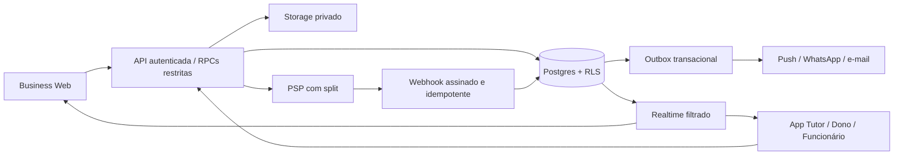

# Arquitetura de referência e fronteiras de implementação

## O que há no repositório

- `apps/web`: shell Next.js com login visual e dashboard estático. Ainda não há API, autenticação efetiva ou CRUD.
- `apps/mobile`: shell Expo com entrada Tutor/Business e dados de demonstração. Ainda não há fluxo específico de funcionário autenticado.
- `packages/shared`: tema, tipos e projeção das permissões para UI.
- `packages/domain`: regras puras testáveis, modelos e interfaces de integração. Não executa pagamentos, notificações, consultas ou renderização 3D.
- `supabase/migrations`: esquema inicial preservado, hardening e tabelas adicionais. As migrations não foram aplicadas a um Supabase externo.
- `docs/SCOPE_MATRIX.json`: rastreabilidade de cada requisito; `graphify-out/wiki/index.md`: entrada do grafo.

## Topologia alvo

API, workers e adaptadores do diagrama são componentes a implementar. As interfaces em `ports.ts` não registram fornecedores fictícios.

## Autenticação e autorização

1. Web valida sessão no servidor; mobile persiste sessão em armazenamento seguro, trata renovação e deep links.
2. Resolver usuário com Auth; não confiar em claims editáveis pelo usuário para organização, cargo ou plano.
3. Em cada operação Business, carregar membro ativo e permissão na organização solicitada. Dono não é administrador global.
4. Convite de funcionário parte do dono no web, expira, vincula e-mail/identidade e não envia senha compartilhada. Criação de Auth administrativo fica no servidor.
5. Onboarding cria profile, organização e proprietário em transação/fluxo idempotente. Tutor pode ter perfil de negócio e de tutor simultaneamente.
6. Resolver acesso do tutor por vínculo ao pet e vínculo ativo à loja; receber `userId`, `tutorId` ou `organizationId` no payload não prova autorização.
7. `can()` e `canWithMembership()` ajudam a interface. SQL/RPC/API continuam obrigatórios. Sobrescrita explícita false nega; custom_permissions adiciona grants; owner é integral em sua organização.
8. O backend de usuário deve usar JWT do usuário e políticas/RPCs restritas. As novas tabelas fechadas precisam dessas políticas antes de uso; não contornar isso usando service_role indiscriminadamente.
9. Reservar service_role a processos internos estreitos, como webhook validado e workers, com invariantes de tenant verificadas. Nunca enviar essa chave ao web/app.

## Contratos de operações a implementar

Prefixo proposto: `/api/v1`. Os caminhos abaixo são especificação; ainda não existem handlers.

| Área | Operações propostas | Autorização e efeitos |
|---|---|---|
| Identidade | POST /onboarding/business; POST /organizations/:org/invitations; GET /me/contexts | Sessão; dono para convite; transação e auditoria |
| CRM | GET/POST /organizations/:org/customers; PATCH /customers/:id; POST /crm/tasks | clients.read/write; vínculo tutor/tenant |
| Pets | GET/POST /organizations/:org/pets; GET /me/pets | pets.read/write ou propriedade |
| Agenda | GET /organizations/:org/availability; POST /appointments; POST /appointments/:id/reschedule | Sessão, vínculo, preço autoritativo, trava/constraint de disponibilidade |
| Jornada | POST /appointments/:id/events | appointments.write ou grant específico futuro; versão esperada e chave idempotente |
| Mídia | POST /pets/:id/uploads; GET /media/:id/download | Validar acesso, tipo/tamanho, finalidade e visibilidade |
| PetStyle | GET/POST /pets/:id/styles; POST /styles/:id/confirm | PetStyle habilitado e autorização do tutor/equipe; versão |
| Loja | GET /organizations/:org/catalog; POST /organizations/:org/products | Vínculo ativo para catálogo; store.write para manutenção |
| Checkout | POST /checkout/quotes; POST /checkout/sessions; GET /orders/:id | Preços/estoque no servidor; uma organização; idempotência |
| Pagamentos | POST /webhooks/payments/:provider; POST /orders/:id/refunds | Assinatura webhook; finance.write e política de estorno |
| Assinaturas | POST /subscriptions; POST /subscriptions/:id/cancel | Oferta aprovada, aceite e titular; sem preço escolhido pelo cliente |
| Clube de serviços | GET/POST /service-plans; POST /service-redemptions | Pet shop/tutor vinculados; consumo atômico |
| Fidelidade | GET /rewards; POST /rewards/redemptions; POST /referrals; POST /reviews | Saldo no servidor, deduplicação, titular e atendimento válido |
| Saúde/ID | GET/POST /pets/:id/health; POST /pets/:id/identity; GET /public/pet-id/:token | Privado por padrão; endpoint público retorna projeção consentida mínima |
| Notificações | POST /me/push-devices; PATCH /me/notification-preferences | Próprio usuário, consentimento, token protegido |
| Financeiro/equipe | GET /organizations/:org/finance; GET /staff/metrics; POST /staff/targets | finance.read/reports.read/team.manage conforme operação |
| Marketing | POST /campaigns; POST /campaigns/:id/approve | Aprovação, segmento do tenant e consentimento |
| IA futura | Nenhum endpoint habilitado | Flag desligada; proposta sujeita a avaliação e aprovação |

Contrato comum: ID opaco, BRL em centavos inteiros, instantes UTC + timezone da organização para exibição, paginação estável, erros sem dados privados. Escritas devem ter `Idempotency-Key`, usuário autor e correlation ID; retornos 401/403/404, 409 para conflito, 422 para entrada inválida, 503 para integração não configurada. Não devolver sucesso simulado.

## Checkout e processamento confiável

1. Carregar catálogo/serviços autorizados e preços atuais no servidor; validar vínculo, tenant, estoque e agenda.
2. Recalcular quote com `quoteCheckout`. O código puro não valida credenciais nem estoque. Não aceitar centavos enviados pelo cliente como preço final.
3. Reservar estoque/horário e criar pedido pendente em transação. TTL libera reservas abandonadas.
4. Criar sessão no PSP com recebedor verificado e chave idempotente. Falha/timeout precisa recuperar a mesma sessão, não criar cobrança duplicada.
5. Webhook verifica bytes originais, assinatura, identificação do merchant, moeda, valor e pedido. Registrar event ID único antes de processar. Eventos fora de ordem não regridem pagamento confirmado.
6. Em transação: atualizar pagamento/pedido, consumir reserva, gravar ledger e outbox. Redirecionamento de navegador não quita pedido.
7. Estorno usa valores do snapshot original, compensação do split/ledger, limites de valor restante e reposição de estoque por política. Nunca recalcular histórico com preço atual.
8. Reconciliar periodicamente pedidos, cobranças, repasses, reembolsos e taxas. Livro append-only registra correções por lançamentos compensatórios.

## Sincronização, mídia e dados privados

Realtime invalida caches; clientes recarregam a projeção autorizada. Cache inclui usuário/organização e é limpo na troca de contexto. Reconexão recupera por cursor/versão. Não há garantia offline implementada: escritas offline precisam de conflito explícito.

Buckets de foto/documento/estilo devem ser privados. URL assinada curta é emitida após autorização; path tem organização/pet/ID aleatório. MIME, tamanho, conteúdo e metadados pessoais precisam de validação. Revogação bloqueia novas URLs; uma URL já assinada pode continuar válida até expirar. RLS de metadados não substitui política em storage.objects.

`appointments.internal_notes`, `pets.notes` e `products.cost_cents` permanecem preservados, mas só são acessíveis por RPC Business autorizada após 0002. Consultas diretas precisam projetar colunas permitidas, sem `select('*')`. Realtime/replicação e views devem usar a mesma separação.

Petyra ID usa token aleatório de alta entropia, hash armazenado, rotação e revogação. Endpoint público não pode devolver linhas completas de pet/documento. Rate limit e deduplicação de aviso impedem spam de escaneamento.

## PetStyle, métricas e IA

O contrato de estilo versiona regiões, técnica e comprimento em milímetros. Renderizador e assets 3D reais ainda são necessários; um campo JSON não equivale a editor 3D.

Métricas têm definição e janela: visitas concluídas, ticket de pagamentos líquidos no período, LTV acumulado reconciliado e recuperação atribuída uma única vez. Frequência/riscos precisam de parâmetros por serviço; não inventar limiares de negócio.

Copiloto futuro deve consumir apenas dados autorizados, começar com leitura/recomendações, avaliar qualidade/custo e exigir aprovação para campanha ou operação financeira. Não inserir chamadas de IA nas jornadas atuais.
